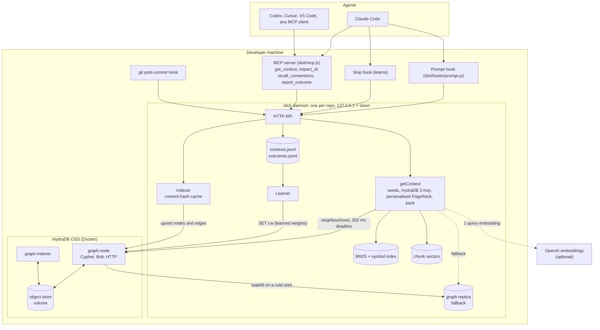
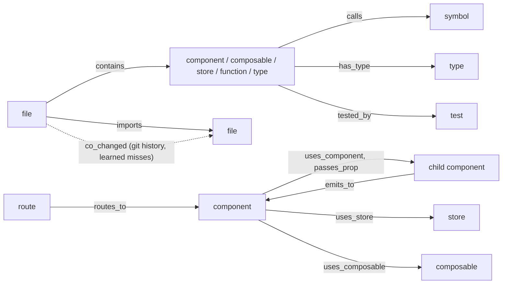
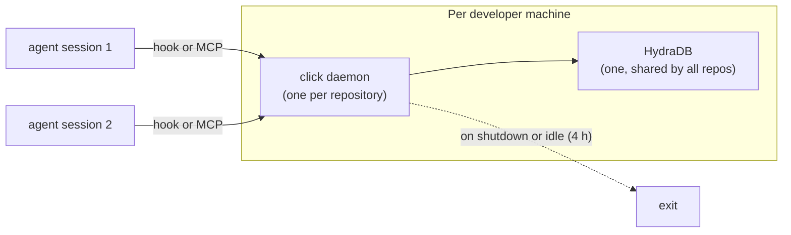
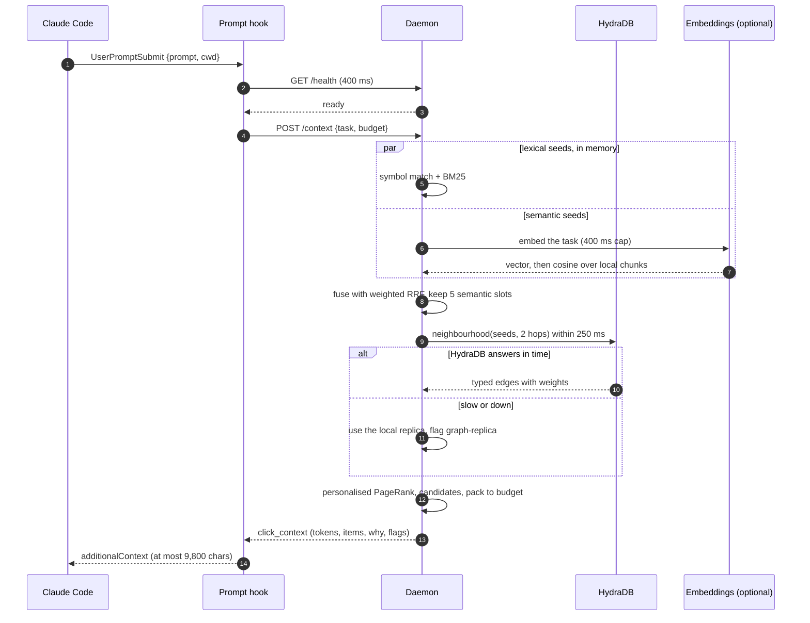
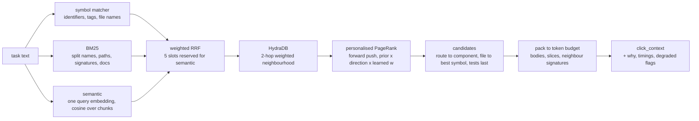
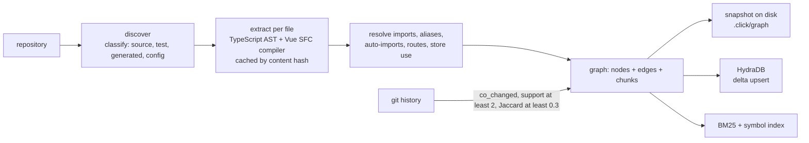
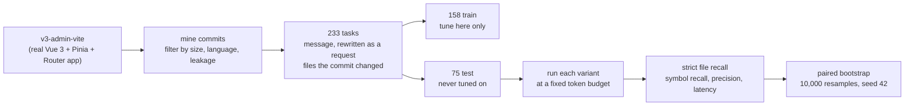
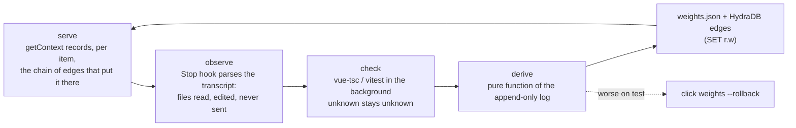
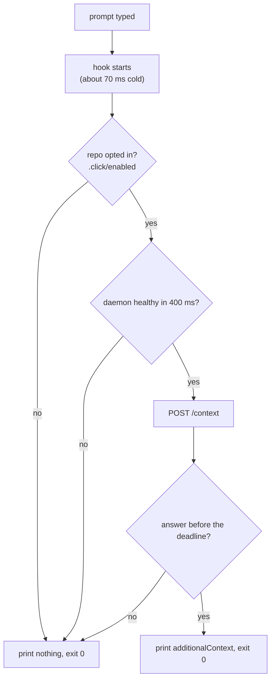
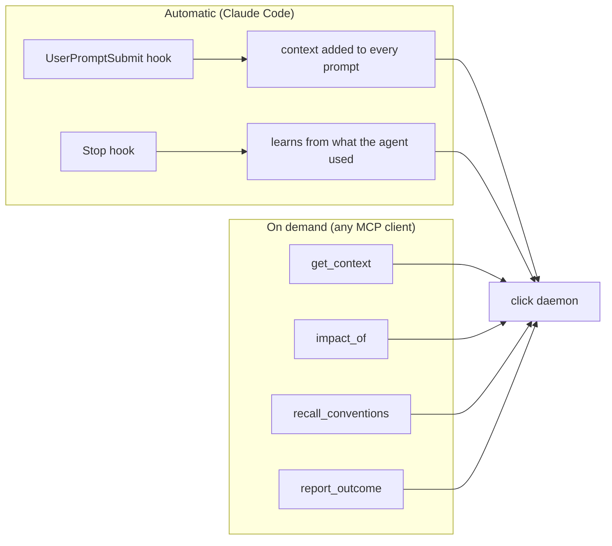

<div align="center">

# Click

**Structure-aware context for coding agents.**
A code graph in a self-hosted [HydraDB](https://github.com/hydra-db/hydradb) picks the right functions, components and stores for a task, and packs them into a fixed token budget, in well under a second.

[**Live site**](https://click.ishaandev.co.in/) · [Quickstart](docs/QUICKSTART.md) · [Benchmark](#5-the-benchmark) · [Architecture](#3-architecture) · [How it fails](#7-it-never-blocks-you)

  -FF571A)  

</div>

---

## Contents

1. [What Click is, and why](#1-what-click-is-and-why)
2. [Try it](#2-try-it)
3. [Architecture](#3-architecture)
4. [How a request works](#4-how-a-request-works)
5. [The benchmark](#5-the-benchmark)
6. [Learning](#6-learning)
7. [It never blocks you](#7-it-never-blocks-you)
8. [Using Click with your agent](#8-using-click-with-your-agent)
9. [Reference](#9-reference)
10. [Repository layout](#10-repository-layout)
11. [Design decisions](#11-design-decisions-and-trade-offs)
12. [Scale, security, licensing](#12-scale-security-licensing)
13. [Limitations, stated plainly](#13-limitations-stated-plainly)

---

## 1. What Click is, and why

A coding agent spends most of its budget **finding** code, not writing it. It greps, opens whole files, follows an import, opens another file. That costs tokens and minutes, and it still misses the files that matter, because the relation that links them is not in their text. Rename a Pinia store action and the thing that breaks is a component that calls it, a route guard that depends on it and a test that mocks it. None of them mentions the store by name. Vector search finds code that *reads like the task*; it cannot find code that is *connected to it*.

Click makes the connection explicit. It reads a **Vue 3 + TypeScript + Pinia + Vue Router** repository as a graph (components, stores, composables, routes, functions, tests; imports, calls, store use, route mounts, co-changes) and keeps that graph in a **self-hosted HydraDB**. One function does the work:

```ts
getContext(task: string, budget: number): PackedContext
```

It runs behind a small per-repository **daemon on your machine**. An agent reaches it through a **Claude Code hook** (context is added to every prompt automatically) or an **MCP server** (any MCP client can ask for context, impact and conventions). The answer is the few functions the task needs, read fresh from disk, each with the reason it is there, inside the token budget you gave.

### The three questions this project is judged on, answered with numbers

| Question | Answer | Evidence |
| --- | --- | --- |
| **Do we measure what matters?** | **Strict file recall at a fixed token budget**: the share of files a real commit changed whose *code* is inside the packed context. Naming a file or showing its signature does not count. Because the budget is fixed, a system cannot win by sending more. | 233 tasks mined from the git history of a real Vue app; 75 held out and never tuned on. Oracle ceiling 98.6%, random 11.2%. |
| **Is HydraDB doing real work, or is it a plain store?** | **Yes, measurably.** The same pipeline *without* the graph walk loses **4.0 pp at 4k tokens** and **10.8 pp at 8k** (paired-bootstrap 95% intervals exclude zero). On "what else must change?" tasks the graph adds **+31 pp**. The price is latency: about **+780 ms p95**. | [Section 5](#5-the-benchmark), [live charts](https://click.ishaandev.co.in/) |
| **Does it learn?** | **The mechanism works end to end; the payoff is not yet proven.** Held-out gain is **+1.0 pp [−1.3, +4.3]**, interval includes zero, measured on *simulated* outcomes, not real agent sessions. We say so rather than oversell. | [Section 6](#6-learning) |

---

## 2. Try it

You need **Node 20+**. Docker is only needed for the full HydraDB setup (step 4). Full details and per-agent setup: [docs/QUICKSTART.md](docs/QUICKSTART.md).

### 2.1 Judge path: five minutes, no Docker

```bash
npm install -g click-context          # installs the `click` command
git clone https://github.com/un-pany/v3-admin-vite && cd v3-admin-vite     # any Vue 3 repo works
click index                           # builds the code graph (a few seconds)
click context "when a user logs out, clear the session and the open tabs" --budget 4000
```

You get the functions, components and stores the task needs, each with why it was chosen, packed to the budget. Without HydraDB the graph walk runs from a local copy and the output says so (`degraded="graph-replica"`).

### 2.2 Full path: with the real HydraDB

```bash
git clone https://github.com/ishaansatapathy/Click && cd Click
corepack enable && pnpm install       # pnpm 9
pnpm hydra:up                         # graph-node + graph-indexer in Docker, waits until /readyz answers
pnpm build                            # the click CLI, the hooks and the MCP server
pnpm demo                             # checks every part, one green or red line each, prints what to show
```

`pnpm demo` starts HydraDB if needed, checks the CLI, the graph, the hook, and sends **one real request** that must be answered *by HydraDB* (no `graph-replica` flag) inside the budget. If it is all green, the system is working on your machine.

### 2.3 Use it with your agent

```bash
click init                            # detects the agents in this repo and wires all of them (idempotent; --dry-run to preview)
click hooks install                   # Claude Code only: add context to every prompt
click status                          # is the daemon up, which graph, what it last served
click uninstall                       # removes only what Click added
```

Then use your agent as you always do. In Claude Code, every prompt now arrives with the relevant code attached. Other MCP clients call the `get_context` tool. See [Section 8](#8-using-click-with-your-agent).

### 2.4 Prove the "never blocks you" claim yourself

```bash
pnpm build && pnpm drill              # ten drills against the real hook: daemon down, hung, corrupt snapshot, ...
```

---

## 3. Architecture

### 3.1 System overview

Everything the hot path needs runs on the developer's machine. HydraDB is the **system of record for the graph** and does the graph work on every request; the daemon keeps an in-memory replica so a slow or absent HydraDB never stops an answer.



### 3.2 What HydraDB does for Click

Click is not a vector store with a graph painted on. Every request and every learning run issues real graph work to HydraDB:

| On every… | HydraDB does | Query shape |
| --- | --- | --- |
| **request** | the weighted 2-hop neighbourhood of the seed nodes, both directions, with edge weights | per-relationship-type `MATCH (a)-[r:T]->(b) WHERE a.id IN $ids RETURN …`, issued in parallel, two rounds (HydraDB patterns take one relationship type each) |
| **`impact_of`** | dependents of a symbol, and the path that links each | `CALL algo.SSpaths({ relDirection: 'incoming', maxLen: 3, … })` |
| **index version** | hub ranking for the stable "skeleton" prefix | `gds.graph.project` + `gds.pageRank.write` + `ORDER BY n.pr DESC LIMIT k` |
| **learning run** | stores the *learned* graph: changed edge multipliers and new co-change edges | per-edge `SET r.w = …` |

The benchmark isolates that work: **V2** (same seeds, no graph) against **V3** (HydraDB graph walk), and **V3** against **V3r** (the same walk over the full local replica, to measure what the HydraDB round trip costs in accuracy and latency). See [Section 5](#5-the-benchmark).

HydraDB has no *personalised* or *weighted* PageRank, so that one step runs in Click (forward push over the fetched subgraph, about 1/(α·ε) pushes regardless of graph size). The neighbourhood query touches only the seeds' 2-hop region, so request cost stays flat as repositories grow.

### 3.3 The graph model



| Node kind | Id | Main fields |
| --- | --- | --- |
| `file` | `file:<path>` | language, content hash |
| `component` | `sym:<path>#<Name>` | props, emits, slots, exposed |
| `composable` | `sym:<path>#useX` | signature, returned keys |
| `store` | `sym:<path>#useXStore` | state, getters, actions |
| `route` | `route:<fullPath>` | name, component, lazy |
| `function`, `type` | `sym:<path>#<name>` | signature, doc |
| `test` | `sym:<path>#<file>` | imported targets |
| `chunk` | `chunk:<path>#<symbol>#<n>` | text and vector (local only, never in HydraDB) |
| `convention` | `conv:<slug>` | text, valid from / to |

Edges are walked in **both directions** on the hot path; the reverse direction is what finds *dependents*, which is what impact questions need. Auto-imports (`unplugin-auto-import`, `unplugin-vue-components`) are resolved, aliases (`@`, `@@`) come from the repo's own tsconfig/Vite config, and Vue SFC templates are parsed for component use, props and emits.

### 3.4 Process model



- The daemon listens on `127.0.0.1`, requires a per-start token header, rejects foreign `Host` headers and caps request bodies at 1 MB. It writes `.click/daemon.json` (pid, port, token) with a lock so two starters never race.
- It boots from the saved snapshot in well under two seconds, then reconciles with `git` (and HydraDB) in the background.
- It exits after 4 hours without requests.

---

## 4. How a request works

### 4.1 The sequence



### 4.2 The pipeline, stage by stage



| Stage | Where | Budget | On timeout or error |
| --- | --- | --- | --- |
| Lexical seeds (symbols + BM25) | memory | ≤ 20 ms | none needed |
| Semantic seeds (one query embedding + cosine) | OpenAI + memory, **parallel** with lexical | 400 ms | lexical-only, flag `semantic-timeout` |
| Fusion (weighted reciprocal-rank) | memory | ≤ 2 ms | none needed |
| **Graph neighbourhood** | **HydraDB** | **250 ms** | local replica, flag `graph-replica` |
| Personalised PageRank | memory | ≤ 20 ms | cap on pushes |
| Pack (bodies read from disk) | local disk | ≤ 30 ms | signature instead of body |
| **Total deadline** | | **1,200 ms** | best result so far |

Only **two network calls** are ever on the wait path (one embedding, one logical HydraDB neighbourhood); a test asserts it.

### 4.3 Packing: the budget is a hard guarantee

- **Units** are symbols (a component, a store action, a function), not file slices. An oversized symbol is cut to its most relevant **chunks** instead of being dropped (`sliceLarge`); this alone moved symbol-level recall from 24% to 78%.
- **Bodies are read from disk at request time**, so they are never stale. If a file changed since it was indexed (hash mismatch) Click sends the signature and queues a re-index.
- Neighbours the budget cannot hold appear as **one-line signatures** (three per body), so the agent knows they exist.
- The packer enforces `tokens ≤ budget` as an invariant (counted with a pinned tokenizer, `cl100k_base`, used identically for every variant) and a character cap for the hook (Claude Code truncates hook context above 10,000 characters; Click stays at ≤ 9,800).
- Every item carries **why** it is there: the seed that matched, or the chain of edges from a seed (`uses_store ← imports`).

### 4.4 Indexing



- **Extraction is cached by content hash**: re-indexing an unchanged repository is nearly free, and a one-file change re-indexes in under two seconds.
- **Co-change edges** are mined from git (merge commits and sweeping commits of more than 30 files are skipped) and, for the benchmark, from history *before* the task's commit only, so there is no leakage.
- A git `post-commit` hook and the daemon's file watcher keep the graph current.

---

## 5. The benchmark

### 5.1 Methodology



- **Tasks are real commits.** The commit message, rewritten as a request, is the input; the files that commit changed are the answer. Types: 141 single-file, 58 multi-hop, 25 multi-file, 9 impact. The graph is built **at the parent commit**, so the answer is never in the index.
- **Strict file recall**: a file counts only if *code from it* is inside the packed context (a body or a whole file; not a signature, not a mention). **Symbol recall** asks the same of the individual functions that changed.
- **Fixed budgets** (4,000 and 8,000 tokens) make variants comparable: nobody wins by sending more.
- **Train/test discipline.** A change is kept only if it improves *train* and does not hurt *test*. Several ideas were tried and **reverted** for failing that rule (late fusion, a sweep winner that did not generalise); the records are in `bench/analysis/`.
- **Every figure is a row** of `bench/results.jsonl`; the live site links each chart to its run id.

### 5.2 The variants

| Variant | What it is |
| --- | --- |
| **oracle** | packs the true files. The ceiling. |
| **random** | packs random files. The floor. |
| **V1** | plain vector search over code chunks. The baseline most tools use. |
| **V2** | Click's seeds (symbols + BM25 + embeddings), **no graph**. |
| **V3** | V2 **plus the HydraDB graph walk**. The product. |
| **V3r** | V3 over the full local replica instead of HydraDB. Isolates the cost of the HydraDB round trip. |
| **V5** | V3 plus learned edge weights. |

### 5.3 Results (75 held-out tasks)

Strict file recall, %. Symbol recall in brackets.

| Variant | 4,000 tokens | 8,000 tokens | p50 / p95 latency (4k) |
| --- | --- | --- | --- |
| random | 11.2 | 18.5 | – |
| V1 vector chunks | 77.0 (symbol 23.8) | 85.4 (27.6) | 326 / 494 ms |
| V2 no graph | 72.9 (72.8) | 72.9 (72.8) | 166 / 254 ms |
| **V3 + HydraDB graph** | **77.0 (77.8)** | **83.8 (82.1)** | 773 / 1,032 ms |
| V3r local replica | 79.6 (77.8) | 84.9 (80.8) | 618 / 862 ms |
| V5 + learned weights | 78.0 (79.3) | 84.4 (82.4) | 661 / 846 ms |
| oracle | 98.6 | 99.8 | – |

**Differences, with 95% intervals** (paired bootstrap, percentage points):

| Comparison | 4k | 8k | Reading |
| --- | --- | --- | --- |
| **V3 − V2** (what the graph adds) | **+4.0** [+1.7, +6.7] | **+10.8** [+5.9, +16.4] | Both exclude zero. The graph helps, and keeps helping as the budget grows. |
| V3 − V2, impact tasks | +31.3 [+25.0, +43.8] | +31.3 | Large, but only 4 held-out impact tasks: wide interval. |
| V3 − V1 (vs plain vector search) | −0.0 [−6.2, +6.0] | −1.6 [−8.3, +5.1] | **A tie on file recall.** |
| V5 − V3 (learning) | +1.0 [−1.3, +4.3] | +0.7 [0.0, +1.7] | Small, inconclusive. |

### 5.4 What this does and does not show

- ✅ **The graph walk is doing real work.** It beats the identical pipeline without it, significantly, and the gap widens with budget.
- ✅ **Symbol recall is about 3x vector search** (78% vs 24%): Click returns *the function that matters*, not a slice of a file. For an agent that edits code, that is the difference between reading 600 tokens and reading 6,000.
- ⚠️ **On whole-file recall, plain vector search ties V3.** We do not claim otherwise. The win over V1 is the precision of what is packed.
- ⚠️ **Latency has a price**: about +780 ms p95 over V2, almost all of it the HydraDB neighbourhood query. A slow HydraDB degrades to the replica instead of waiting.
- ⚠️ **One repository.** The benchmark is open so others can add theirs.
- ⚠️ **Agent-level token savings are not yet measured here.** The end-to-end harness (`pnpm e2e`, below) measures tokens per solved task for a stock agent against the same agent with Click; its first real runs are what turns "the right code in the budget" into "fewer tokens for the agent". Until they exist, we do not claim it.

### 5.5 Reproduce

```bash
pnpm build
pnpm bench                       # the retrieval runner (see bench/); rows append to bench/results.jsonl
pnpm bench:diff                  # compare two runs, paired bootstrap
pnpm --filter @click/dashboard data   # rebuild the dashboard's data from results.jsonl and bench/runs
```

### 5.6 End-to-end: does the agent use fewer tokens?

```bash
pnpm e2e --dry --tasks 1 --variants V0          # free: proves the plumbing (worktree, vue-tsc, check, cleanup)
pnpm e2e --tasks 3 --variants V0,delivery       # real: spends API budget, capped per run
```

For each task and variant the harness checks out the benchmark repo **at the parent commit** in a throwaway git worktree, installs Click (or not, for `V0`), runs **Claude Code headless** with a hard wall-clock and dollar cap, then decides "solved" by the task's own check (`vue-tsc` must not get worse and the task's vitest file must pass). It reports **tokens per solved task** (input, output, cache creation) with **cache reads reported separately**, plus turns and wall time, and writes `docs/e2e/<run>.json`.

---

## 6. Learning

Click watches which of the code it packed the agent actually used, and nudges the weights of the graph edges that led there. The weights are one small document; the next request reads them.



**The rules** (deterministic and replayable; clamp to [0.1, 5] so one bad session cannot dominate):

1. A passing run **reinforces** every edge on the attribution path to each used item, × (1 + α).
2. An item that was packed but unused **decays** the last edge that pulled it in, × (1 − β).
3. A file the agent needed that Click did not send adds or strengthens a **`co_changed`** edge.
4. Failed or unknown runs **change nothing**.

**Honest status.** The loop is implemented and tested end to end (event log, check queue, derivation over 10,000 events in about 75 ms, rollback, sync to HydraDB). The benchmark run used outcomes *simulated from the benchmark's own answers* (158 events), so it shows the loop moves numbers a little (+1.0 pp, interval includes zero), not that it pays off for a real team. That evidence needs real sessions. The learned multipliers a run produced are listed on the site's Learning page.

---

## 7. It never blocks you

The hook is on the critical path of **every prompt you type**, so its contract is strict: it exits `0`, inside its 3-second timeout, printing either nothing or one valid JSON object under 10,000 characters. Exit code `2` would *block* your prompt in Claude Code; Click never produces it.



| Failure | How it is detected | What happens |
| --- | --- | --- |
| Daemon not running | health check (400 ms) | prompt goes through unchanged; the hook never starts a daemon itself |
| Daemon hung | client deadline | hook exits 0 with no output |
| **HydraDB down or slow** | neighbourhood deadline (250 ms) or error | **local replica**, `degraded: graph-replica`; writes queue and retry |
| HydraDB rejects the key | HTTP 401 on every call | same: replica |
| Embedding API down or no key | deadline / error | lexical-only seeds, `degraded: semantic-off` or `semantic-timeout` |
| Snapshot corrupt | parse error at boot | rebuilt from HydraDB, else a full re-index |
| File edited since indexing | hash mismatch at pack time | signature only, re-index queued |
| 100 KB prompt, non-UTF-8 stdin, not a git repo, unwritable `.click/` | handled at the edge | exit 0, empty or valid output |
| Bad learned weights | recall drop on test | `click weights --rollback` |

**`pnpm drill`** turns the table into ten automated drills that run the *real bundled hook* as a child process. Current result: **9 passed, 0 failed, 1 skipped** (the Jev 429 drill is skipped with its reason: the shipped preset has no pruner, so no request ever calls it). The slowest hook run was **1.5 s** against the 3 s timeout.

In normal use (warm daemon, local HydraDB) the hook answers **20 of 20** held-out prompts with a wall-clock **p50 of 405 ms and p95 of 550 ms**, Node start-up included (a `latency` row in `bench/results.jsonl`).

The package was tested on a **clean Linux machine** (`node:20` container): `npm i -g` → `click init` → `click context` → `click status` → MCP server → `click uninstall`. That run found a real bug (on Linux and macOS npm links the bin as a symlink, and the CLI silently did nothing); it is fixed.

---

## 8. Using Click with your agent

Click is agent-agnostic. Two doors lead to the same daemon:



| Agent | How it connects | What `click init` writes |
| --- | --- | --- |
| **Claude Code** | prompt hook + Stop hook (automatic), and MCP | `.claude/settings.local.json` hooks, `.mcp.json`, a marked block in `CLAUDE.md` |
| **Codex** | MCP server | the MCP entry in Codex's config and a marked block in `AGENTS.md` |
| **Cursor, VS Code, any other MCP host** | MCP server over stdio (`node dist/mcp.js`) | a host-neutral project `.mcp.json` registration; `init` detects Claude Code, Codex, Cursor and VS Code |

Everything `init` writes is **idempotent** and **byte-exactly reversible**: `click uninstall` removes only Click's blocks and keeps the graph and cache. Click is **opt-in per repository** (`.click/enabled`); it never acts in your home directory.

**MCP tools**

| Tool | Use it for |
| --- | --- |
| `get_context(task, budgetTokens?)` | **Call first** for any task that changes code. Returns the relevant code within the budget, with why each item is there. |
| `impact_of(symbol)` | Before changing a symbol: dependents (components, stores, composables, routes, tests) and the edge chain to each, up to three hops. |
| `recall_conventions()` | The repository's current conventions and when they became valid. |
| `report_outcome(contextId, …)` | After the task: tells Click what helped, so it can learn. |

> The hook path is capped by Claude Code at 10,000 characters (about 2.5k tokens of code); the MCP path has no such cap, which is why it is recommended for large budgets.

---

## 9. Reference

### 9.1 CLI

| Command | What it does |
| --- | --- |
| `click init [--dry-run]` | install Click for the agents found in this repository |
| `click uninstall` | remove Click's agent integrations (keeps graph and cache) |
| `click index [--full]` | build or refresh the code graph |
| `click context "<task>" [--budget N] [--json] [--variant V]` | the context for a task |
| `click serve` | run the per-repository daemon in the foreground |
| `click status [--json]` | daemon health, graph version, last request, HydraDB state |
| `click statusline` | one line for Claude Code's status bar: `Click ▸ 3.1k ctx · 7 files · 240 ms` (install with `click init --statusline`) |
| `click push` / `click pull` | upload the graph to HydraDB / rebuild the local replica from it |
| `click map --stats \| --node <id> \| --path <file>` | inspect the graph |
| `click reindex [--changed] [paths…]` | ask the daemon to refresh |
| `click hooks install \| uninstall \| status` | the Claude Code (and git) hooks |
| `click weights --show \| --rollback` | what Click learned; undo it |
| `click probe` | time HydraDB queries and the embedding (p50 / p95) |

### 9.2 Daemon HTTP API (127.0.0.1, token header)

`GET /health` · `POST /context` · `GET /impact?symbol=…` · `GET /conventions` · `POST /outcome` · `POST /reindex` · `GET /stats` · `GET /weights` · `POST /weights/reload` · `POST /weights/derive`

### 9.3 Configuration (`click.config.json`, optional)

| Key | Meaning |
| --- | --- |
| `privacy.localOnly` | `true` turns semantic seeds off: Click runs fully offline (lexical + HydraDB graph) |
| `daemon.idleMinutes` | shut down after this long without requests (default 240) |
| `hook.mode` | `always` (every prompt, default), `first` (first prompt of a session) or `off` |
| `hook.budgetTokens` | the token budget the hook asks for (500 to 32,000, default 4,000) |
| `learn.gitCoChange` | mine co-change edges from git history |
| anything else | overrides on the `delivery` preset (seeds, expansion, packing) |

Presets: `V1`, `V2`, `V3`, `V3r`, `V4`, and `delivery` (the shipped default, selected on the train split: body-only packing, no stable prefix, session de-duplication).

Environment: `HYDRADB_URL`, `HYDRADB_TOKEN` or `HYDRADB_TOKEN_FILE`, `OPENAI_API_KEY` (optional, embeddings), `CLICK_VARIANT` (pin a preset).

### 9.4 Scripts

| `pnpm …` | |
| --- | --- |
| `check` | typecheck + lint + tests (what every integration runs) |
| `build` | bundle the CLI, hooks and MCP server into `packages/click/dist` |
| `hydra:up` / `hydra:down` / `hydra:reset` / `hydra:logs` | the self-hosted HydraDB |
| `demo` | readiness check with one real request |
| `drill` | the never-block drills |
| `bench`, `bench:diff` | the retrieval benchmark |
| `e2e` | the end-to-end agent harness |
| `test:slow` | the slow integration suites (real git worktrees, cold starts) |

---

## 10. Repository layout

```text
.
├── packages/
│   ├── core/                    the engine, no I/O assumptions beyond its interfaces
│   │   └── src/
│   │       ├── pipeline.ts          getContext(task, cfg, deps): the whole product in one function
│   │       ├── config.ts            variant presets and the schema
│   │       ├── indexer/             discover, extract (AST + Vue SFC), resolve, build, incremental
│   │       ├── retrieve/            symbol matcher, BM25, semantic, fusion, candidates
│   │       ├── graph/               CSR graph, personalised PageRank, weights, snapshot, bodies
│   │       ├── pack/                token-budgeted packer, slicing, prefix
│   │       ├── learn/               event log, check queue, weight derivation, git co-change
│   │       └── store/               HydraDB graph store, in-memory store, embeddings
│   └── click/                   the product around the engine
│       └── src/
│           ├── daemon/              HTTP server, routes, sessions, graph and weight sync, learner
│           ├── hooks/               prompt hook and stop hook (tiny, dependency-free bundles)
│           ├── mcp/                 the MCP server
│           ├── install/             Claude Code, Codex, git hook installers
│           ├── cli/                 one module per command
│           ├── drill/               the never-block drills
│           └── build/               esbuild bundling
├── bench/                       tasks, retrievers, metrics, runner, analysis, results.jsonl
├── apps/dashboard/              the website: landing, sign-in, app (React, Vite, Vercel)
├── infra/hydradb/               docker compose for the self-hosted HydraDB and its lifecycle CLI
├── scripts/                     demo check; pair-mode tooling used to build this project
└── docs/                        quickstart, HydraDB notes, MCP and agent integration notes
```

The code is **TypeScript in strict mode** with a root `pnpm check` (typecheck, lint, roughly a thousand test cases). Core talks to the outside world only through small interfaces (`Store`, `GraphStore`, `Embedder`), each with an in-memory fake and a contract test suite that the real HydraDB implementation must also pass.

---

## 11. Design decisions and trade-offs

| Decision | Why | Cost we accepted |
| --- | --- | --- |
| **A local daemon, not a hosted service** | Code never leaves the machine; a request is sub-second because there is no round trip; our server cost grows with commits, not prompts. | The user runs a process (and Docker for HydraDB). |
| **HydraDB as the graph's system of record, with a local replica** | The graph work (neighbourhoods, impact paths, hub ranking, learned weights) is real database work, and it is what the benchmark isolates. The replica means HydraDB's absence degrades an answer instead of failing it. | About +780 ms p95 when HydraDB is in the path. |
| **Personalised PageRank in Click, not in HydraDB** | HydraDB has no personalised or weighted PageRank. Forward push over the fetched 2-hop subgraph is cheap and independent of repository size. | One stage of ranking logic lives outside the database. |
| **Strict recall at a fixed budget as the headline metric** | A metric that credits mentions or signatures rewards sending more. This one rewards sending the right code. | A harsher, smaller number than "any" recall; we publish both. |
| **Symbols as the unit, with slicing** | Agents edit functions. Packing a function costs a fraction of its file. | More machinery than chunking. |
| **Weights are a pure function of an append-only log** | Replayable, testable, clean train/test split, rollback is trivial. | Learning lags by a debounce (5 s) and a check. |
| **A plain `node:http` client in the hook, `connection: close`** | Keep-alive sockets crashed Node on Windows when the process exited; a cold hook must start in about 70 ms. | Reimplements a little HTTP. |
| **The hook never starts a daemon** | A hook that spawns processes can block a prompt. | The first prompt after a reboot has no context. `click init` starts the daemon, and the MCP path autostarts it. |
| **Honest negative results are published** | The judges are asked whether the evidence is real. | The headline is smaller than it could be. |

---

## 12. Scale, security, licensing

**Scale path.** *One developer:* HydraDB in Docker on a local volume, local indexing. *A team (5-50):* one HydraDB on object storage (same images), CI indexes `main`, each daemon points `HYDRADB_URL` at it and keeps a local replica as fallback; the learned weights become the team's shared graph. *Many repositories:* HydraDB query nodes and indexers scale independently over the object store; extraction is content-addressed, so identical files are indexed once.

**Privacy and security.**
- The daemon and HydraDB listen on `127.0.0.1` only; a random token per start; HydraDB usage reporting is disabled.
- Code leaves the machine only to the embedding provider (chunk text, cached), and `privacy.localOnly` turns even that off.
- The hook is opt-in per repository and never reads outside it; the daemon refuses foreign `Host` headers and bodies over 1 MB; secrets (`HYDRADB_TOKEN`, `OPENAI_API_KEY`) are never logged.
- The website's sign-in uses Google OAuth with a state-nonce cookie and a signed `HttpOnly` session; it stores no account data.

**Licensing.** Click's own code is **MIT**. HydraDB is under the **Elastic License 2.0**: free to self-host and to build on, but offering HydraDB itself as a managed service is not allowed. Click never does: it runs *your* HydraDB, unmodified, in Docker. A future team plan would deploy HydraDB **in the customer's own cloud** and sell Click's service on top (or partner with the HydraDB team), which also means a customer's code graph never leaves their account. The sample repository in the benchmark, [v3-admin-vite](https://github.com/un-pany/v3-admin-vite) by pany, is MIT.

---

## 13. Limitations, stated plainly

- **Vue 3 + TypeScript + Pinia + Vue Router only.** The graph builder is per framework; React or Svelte would be a new extractor, not a new product.
- **One benchmark repository** (233 tasks). The numbers are real and reproducible, but they are one repository's numbers.
- **On whole-file recall, plain vector search ties Click.** The advantage is symbol-level precision and the graph's gain over the same pipeline without it.
- **Learning is not shown to pay off.** The gain is small, its interval includes zero, and it was measured on simulated outcomes.
- **Agent-level token savings need the end-to-end runs** (`pnpm e2e`); they are not claimed until those rows exist.
- **HydraDB adds latency** (about +780 ms p95 in the benchmark setup).
- **The Claude Code hook is capped at 10,000 characters** by Claude Code itself; use MCP for larger budgets.
- **Semantic search needs an `OPENAI_API_KEY`** and is optional; without it Click uses symbols, BM25 and the graph.

---

<div align="center">

Built for the HydraDB hackathon. Code: MIT. Graph database: [HydraDB OSS](https://github.com/hydra-db/hydradb), self-hosted, unmodified.

[Live site](https://click.ishaandev.co.in/) · [Quickstart](docs/QUICKSTART.md) · [Open an issue](https://github.com/ishaansatapathy/Click/issues)

</div>
